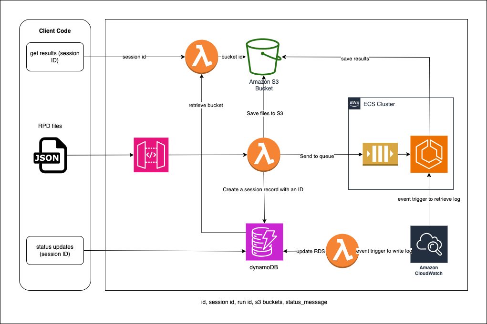

# Getting Started

## Architecture



---

## Environment Variables

Create a `.env` file at the root of the project.

You can use `default.env` as a template:

```bash
cp default.env .env
```

Then fill in the required values for your environment.

---

## Configure Your AWS Profile

Set up an AWS CLI profile in `~/.aws/config`.

You can authenticate using **AWS SSO** *or* **access keys**.

### Option 1 — AWS SSO (Recommended)

```ini
[sso-session my-sso]
sso_start_url = https://your-org.awsapps.com/start
sso_region = us-west-2
sso_registration_scopes = sso:account:access

[profile my-project]
sso_session = my-sso
sso_account_id = <your-account-id>
sso_role_name = <your-role-name>
region = us-west-2
```

Log in:

```bash
aws sso login --sso-session my-sso
```

---

### Option 2 — Access Keys

```ini
[profile my-project]
aws_access_key_id = <your-access-key-id>
aws_secret_access_key = <your-secret-access-key>
region = us-west-2
output = json
```

---

## Infrastructure Requirements and Assumptions

### VPC Requirements
- A pre-existing VPC must be available and its ID must be provided via `vpcId` prop
- The VPC must have subnets configured with `PRIVATE_WITH_EGRESS` access
- The VPC is used by both the API stack and API key rotation stack

### Stack Dependencies
1. VPC must be deployed first
2. RCT Resource Stack must be deployed before the main RCT CDK Stack
3. Resources with RETAIN removal policy will persist after stack deletion
4. API keys and usage plans are managed through the CDK deployment

### Required Stack Properties
All stacks require:
- `resourcePrefix`: String used to prefix all resource names
- `vpcId`: ID of the existing VPC to use

### Resource Stack Details
- Creates versioned resources for each API version
- Per version resources:
  - Input S3 bucket (KMS encrypted, public access blocked)
  - Output S3 bucket (KMS encrypted, public access blocked, versioning enabled)
  - DynamoDB session table
- S3 buckets use RETAIN removal policy
- Session tables use DESTROY removal policy

### API Configuration
- Uses "prod" stage
- Supports binary media types (application/octet-stream, application/zip)
- Requires API key for most endpoints
- Has usage plan with rate limiting (2 req/s, burst 3)
- Daily API key rotation with SNS notifications

### Lambda Functions
- Runtime: NodeJS 20.x
- Timeout: 30 seconds
- VPC access: Requires private subnet access
- Required permissions:
  - DynamoDB table access
  - S3 bucket access
  - API Gateway permissions
  - Systems Manager Parameter Store access

### Parameter Store Requirements
The following SSM parameters are managed:
- `/{resourcePrefix}-api-key-id`: Stores the API Gateway API key ID
- `/{resourcePrefix}-usage-plan-id`: Stores the usage plan ID

---

## Useful CDK Commands

List all stacks:

```bash
npx cdk ls
```

Deploy all stacks:

```bash
npx cdk deploy --profile my-project --all
```

Deploy a single stack:

```bash
npx cdk deploy <stack-name> --profile my-project
```

If Docker build issues occur during deploy:

```bash
BUILDX_NO_DEFAULT_ATTESTATIONS=1 npx cdk deploy <stack-name> --profile my-project
```

See differences between deployed and local stack:

```bash
npx cdk diff --profile my-project